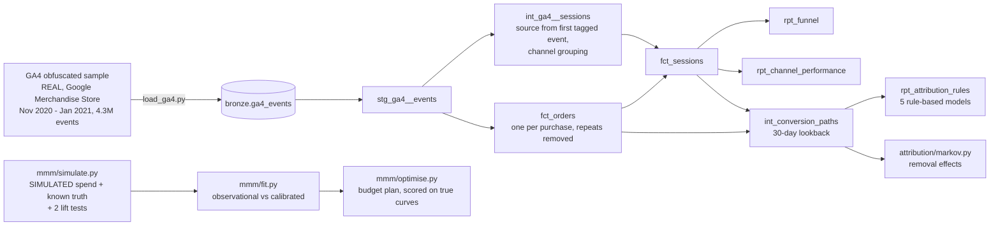

# Marketing Mix Model & Attribution on GA4 Data

[](https://github.com/Saigwe/marketing-mix-attribution/actions/workflows/ci.yml)

> Two answers to "what is marketing worth?", built the way an analytics team would and tested against ground truth. **Attribution** on Google's real GA4 sample from its Merchandise Store: 4.3M events become 360,129 sessions, a purchase funnel and channel credit under seven models, from last click to a data-driven Markov chain. A **marketing mix model** on simulated spend with known true returns tests whether the model, and the budget plan it recommends, can be trusted.

**Author:** Stanley Igwe, Lead Data (Analytics) Engineer · [Portfolio](https://saigwe.github.io)
**Stack:** Python · DuckDB · dbt Core · [dbt-trust-tests](https://github.com/Saigwe/dbt-trust-tests) · SciPy · GitHub Actions
**Status:** ✅ `dbt build` 25/25, pytest 10/10. CI downloads the 1.8 GB GA4 sample, checks its sha256 and rebuilds everything.

Project 6 of my portfolio plan, for marketing-analytics roles. It isn't a rebuild of client work: it shows how I'd approach attribution and media measurement, with the same rule as my other projects, that a number isn't trusted until something independent checks it.

---

## 90-second summary
| | |
|---|---|
| **Problem** | Marketing asks two questions with different tools. *Which channels drive sales?* is answered from web analytics with an attribution model, and the answer changes with the model. *Where should next quarter's budget go?* needs a marketing mix model, which is notoriously hard to identify from observational data. |
| **What I built** | dbt models that turn raw GA4 events into sessions, a funnel, order-level conversion paths and five rule-based attribution models, plus a Markov removal-effect model in Python, all reconciled to revenue. Then a mix model (adstock, saturation, baseline) fitted to three years of simulated weekly data, with and without calibration from lift experiments, scored on recovering the true return of each channel and on the revenue its budget plan would really make. |
| **Why it matters** | It shows how far attribution answers move with the model, what an MMM can and can't tell you, and why experiments matter, before anyone reallocates real budget. |
| **Proof** | Every attribution model hands out exactly the $340,647 of revenue in the sample (tested). The calibrated MMM cuts the average ROI error from 0.61 to 0.16, but neither model's budget plan beats the current allocation on the true curves. See [Results](#results). |

## Architecture


## Data
**GA4 (real).** [Google's public GA4 obfuscated sample](https://developers.google.com/analytics/bigquery/web-ecommerce-demo-dataset) for the Google Merchandise Store, 1 Nov 2020 to 31 Jan 2021, as flattened to one row per event by the Hugging Face dataset [gizdevans/ga4-bq-flattened-data](https://huggingface.co/datasets/gizdevans/ga4-bq-flattened-data), so it can be downloaded without a Google Cloud account. Three things about this file shape every number:
- **Obfuscation.** Google masks part of the sample: sources show as `<Other>` or `(data deleted)`. Those sessions are channel **Unknown**, 42% of sessions and 27–39% of revenue depending on the model. Attribution here is about method; on a real property that share would be near zero.
- **Session source.** This export doesn't carry source and medium on `session_start`, so a session takes them from its first event that has them. The store referring to itself is a self-referral, counted as Direct, as GA4's unwanted-referral setting would.
- **Orders.** 906 purchase events have no transaction id and some ids repeat across users. An order is a purchase event per user, transaction id and amount, with exact repeats removed: 5,692 purchase events ($362,165) become **5,372 orders ($340,647)**. The file also repeats its header row 31 times inside the data; the loader drops and counts those rows.

**Marketing mix (simulated).** GA4 has no media spend, and no public dataset pairs real spend with a known true return. So the mix model is tested where the answer is known: 156 weeks of revenue for an online store with a trending, seasonal baseline, Black Friday, promotions, and four channels (paid search, paid social, display, online video), each with its own carry-over, diminishing returns and true ROI. Search and social spend move together, as they do in real plans. Two **geo lift experiments** (paid social, online video) measure their channel's true ROI with a standard error of 0.25 and 0.30. The truth is read only by the scoring.

## Results

### Funnel (real)
| Step | Sessions | From previous step |
|---|---:|---:|
| Session | 360,129 | |
| View item | 77,020 | 21.4% |
| Add to cart | 15,188 | 19.7% |
| Begin checkout | 11,106 | 73.1% |
| Add shipping info | 11,105 | 100.0% |
| Add payment info | 6,815 | 61.4% |
| Purchase | 4,848 | 71.1% |

1.35% of sessions purchase: 1.32% on desktop, 1.39% on mobile, 1.30% on tablet. The biggest leaks are from browsing to viewing a product, and from viewing to adding to cart.

### Channels (real; revenue credited to the purchasing session)
| Channel | Sessions | Engaged | Orders | Revenue | Revenue per session |
|---|---:|---:|---:|---:|---:|
| Direct | 94,284 | 83% | 1,949 | $132,580 | $1.41 |
| Organic Search | 97,388 | 94% | 1,800 | $106,711 | $1.10 |
| Unknown (obfuscated) | 152,367 | 89% | 1,462 | $92,238 | $0.61 |
| Referral | 6,892 | 87% | 88 | $4,178 | $0.61 |
| Paid Search | 7,672 | 98% | 48 | $3,114 | $0.41 |
| Email | 197 | 92% | 23 | $1,659 | $8.42 |
| Affiliates | 1,329 | 82% | 2 | $167 | $0.13 |

### Attribution: share of revenue by model (real)
Paths are each order's sessions in the 30 days before the purchase: 43% of orders have a single touch, and the average path is 2.5 sessions (longest 12). Every model hands out exactly the $340,647 (tested).

| Channel | Last click | Last non-direct | First click | Linear | Position-based | Time decay (7-day) | **Markov** |
|---|---:|---:|---:|---:|---:|---:|---:|
| Direct | 38.8% | 14.2% | 23.5% | 32.7% | 31.8% | 33.0% | **33.8%** |
| Organic Search | 31.4% | 42.7% | 41.2% | 34.3% | 35.5% | 34.3% | **33.7%** |
| Unknown | 27.2% | 39.4% | 31.2% | 29.9% | 29.5% | 29.7% | **28.7%** |
| Referral | 1.2% | 1.8% | 2.1% | 1.5% | 1.6% | 1.5% | **2.0%** |
| Paid Search | 0.9% | 1.3% | 1.7% | 1.2% | 1.3% | 1.1% | **1.3%** |
| Email | 0.5% | 0.6% | 0.3% | 0.4% | 0.4% | 0.5% | **0.4%** |
| Affiliates | 0.0% | 0.0% | 0.0% | 0.0% | 0.0% | 0.0% | **0.2%** |

What it says:
- **The model is a choice with consequences.** Direct takes 38.8% of revenue under last click and 14.2% under last non-direct click, the default in GA4 reports. A team using one model would fund different channels from a team using the other.
- **Organic search starts journeys.** It earns more credit for first touches (41%) than last (31%).
- **The data-driven Markov model sits between the extremes** for the big channels. It credits each channel by how many conversions would be lost without it, using 265,735 non-converting journeys as well as the 5,372 converting ones.
- **Paid search is small here** (1–2%) because the store barely advertises in this sample. That's a finding about this store, not about paid search.

### Marketing mix model (simulated, scored against the truth)
Two models fit the same three years: **observational** (revenue and spend only) and **calibrated** (the same model, also matched to the two lift tests, weighted by their standard errors as a Bayesian prior would be). Both forecast the last 26 weeks, which they never saw, within **3.6% MAPE** and explain 93% of weekly revenue, so fit alone can't tell them apart.

| Channel | True ROI | Observational (90% interval) | Calibrated (90% interval) |
|---|---:|---|---|
| Paid search | 2.40 | 2.49 (1.82–3.52) | 2.47 (1.78–3.41) |
| Paid social | 1.50 | 1.15 (0.85–1.52) | 1.06 (0.82–1.35) |
| Display | 0.60 | 0.69 (0.41–1.86) | 0.71 (0.51–2.19) |
| Online video | 1.10 | **3.00** (0.63–4.94) | **1.14** (0.72–1.51) |
| **Mean absolute error** | | **0.61** | **0.16** |

Media share of revenue: 28.5% true, 32.4% observational, 27.2% calibrated. Intervals are from a 40-draw moving-block bootstrap of the residuals.

What it says:
- **Without experiments, the model can't tell carry-over from return.** Online video runs in long flights with slow decay, and the observational model credits it with nearly three times its true ROI. Its interval (0.63–4.94) is honest about that: wide enough to be useless for a budget decision.
- **One experiment fixes the channel it measures.** The video lift test pulls the estimate to 1.14 against a true 1.10.
- **An experiment is only as good as its luck.** The social test happened to come in at 0.95 against a true 1.50, more than two standard errors low (a fixed seed; I didn't redraw it). The calibrated model follows it to 1.06 and now misses the truth with a tighter interval. That's the case for repeating experiments, not trusting one.

**Budget plan.** The optimiser moves the same $64,948 a week between channels (each within 50–150% of today), using each model's response curves, and is then scored on the **true** curves:

| | Paid search | Paid social | Display | Online video | True media revenue / week | vs today |
|---|---:|---:|---:|---:|---:|---:|
| Today | $24,419 | $18,627 | $12,713 | $9,189 | $113,796 | |
| Observational plan | $21,064 | $27,940 | $10,413 | $5,530 | $112,904 | **−$892** (the model promised +$3,993) |
| Calibrated plan | $20,448 | $27,940 | $9,987 | $6,572 | $113,195 | **−$601** (promised +$3,118) |
| Best possible (true curves) | $28,997 | $21,680 | $6,357 | $7,914 | $118,588 | +$4,792 |

**Neither plan beats today's allocation**, although both models predict they will. Average ROI was much better after calibration, but a budget move depends on the *marginal* return, the slope of each curve where you are now, and neither model pins that down from three years of observational data. The right move is to cut display (true ROI 0.6) and add to search; both models instead push social to its cap.

The lesson I'd take to a marketing team: **use the MMM to decide which experiments to run next, not to move budget on its own.** Here that means a search test and a repeat of the social test before anything is reallocated.

## Tests
- **dbt (25):** keys and grain on every model (`trust_tests.unique_combination`); accepted channel groups; every order belongs to a session; session revenue and channel revenue reconcile to orders (`trust_tests.reconciles_to`); **every attribution model hands out exactly all orders and revenue**; the funnel never exceeds its session count.
- **pytest (10):**
  - adstock carries over geometrically; the Hill curve is half-saturated at its midpoint and bounded; steady state matches a long flight
  - the simulator hits each channel's target ROI, and the lift tests are noisy measurements of the truth
  - the optimiser keeps the budget and the ±50% guardrails and never does worse than the current plan on its own curves
  - Markov: conversion probability matches the journeys; a channel on every converting path has removal effect 1; symmetric channels get equal credit, which sums to the total; a channel that never leads to a sale gets none

## Run it
```bash
pip install -r requirements.txt
make all     # download the GA4 sample (1.8 GB, sha256-checked) -> load -> dbt -> attribution -> MMM -> pytest
```
The MMM step takes a few minutes; `make mmm BOOTSTRAP=5` is quicker with rougher intervals.

## Roadmap
- [x] GA4 sessions, funnel, channel performance, five rule-based attribution models and a Markov model, reconciled to revenue
- [x] Simulated MMM with known truth: observational vs lift-test-calibrated, bootstrap intervals, budget optimiser scored on true curves
- [ ] A fully Bayesian MMM (PyMC-Marketing or Meridian) on the same simulation, to compare intervals
- [ ] Rerun attribution on an unobfuscated GA4 property
- [ ] 3-minute Loom walkthrough ([script ready](docs/walkthrough.md))

## Data licence
- **GA4 sample:** Google's public demo dataset for the Google Merchandise Store; the flattened copy is published on Hugging Face under MIT. It is downloaded, not redistributed.
- **Simulated marketing data:** generated by `mmm/simulate.py` with fixed seeds.
- **Code:** MIT (see `LICENSE`).
